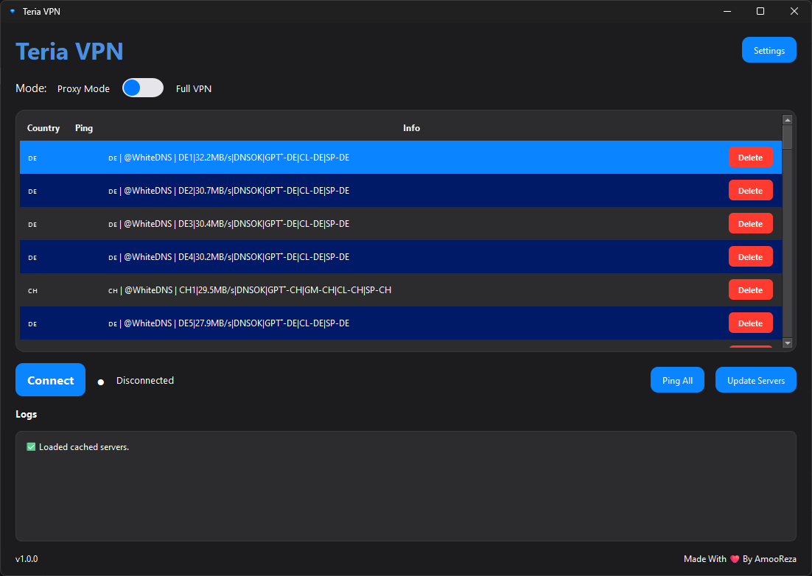
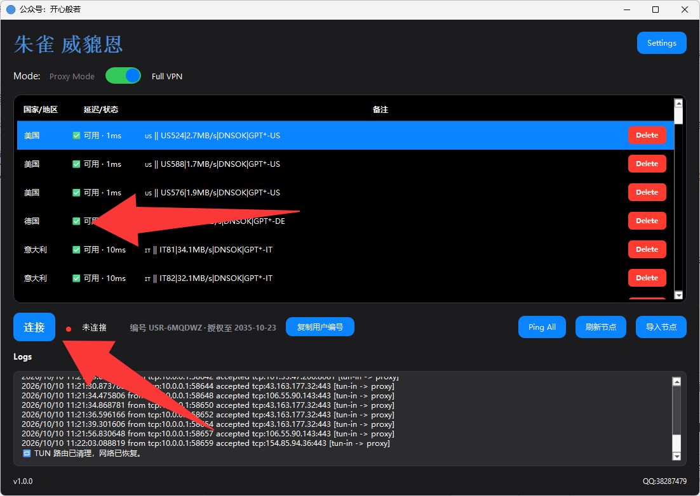
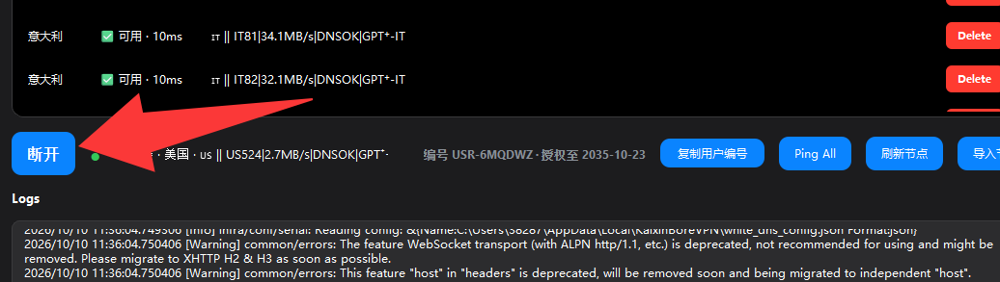

# 朱雀 VPN（zhuqueVPN）

> 自建可控的 Windows VPN 客户端 · 隐私掌握在自己手里

---

## 简介

朱雀 VPN 是一个基于 [Xray-core](https://github.com/XTLS/Xray-core) 的 Windows VPN 客户端，支持**代理模式（SOCKS5）**与**全局 TUN 模式**。与商业 VPN 不同，它面向「自己部署、自己掌控」的场景——流量只经过你指定的服务端，客户端不收集个人隐私数据。

## 功能特性

- 🔒 **VLESS 订阅**：一键更新服务器列表
- 🧦 **代理模式**：本地 SOCKS5 代理（`127.0.0.1:10890`）
- 🌐 **全局 VPN 模式**：系统级 TUN 隧道（需管理员权限）
- 📡 **Ping 测速**：实时测量所有节点延迟
- 🛡️ **断网保护（Kill Switch）**：VPN 意外断开时阻断联网，防止 IP 泄漏
- 🚀 **开机自启**：随 Windows 自动启动（可选）
- 🎨 **暗色现代界面**：PySide6 打造，支持系统托盘

## 下载

前往 **[Releases](https://github.com/borrow01/zhuque-rel-8k2m/releases/latest)** 下载最新版 `Teria VPN.exe`。

> 安装包托管在 GitHub Releases，经全球 CDN 加速，下载飞快。文件为单文件绿色版，无需安装 Python。

## 使用说明

1. 下载 `Teria VPN.exe` 并双击运行（首次运行会请求**管理员权限**，用于创建 TUN 虚拟网卡）。
2. 打开后输入**激活码**完成激活（激活码请向分发者获取）。
3. 点击「**更新服务器**」拉取最新节点列表。
4. 在列表中选择一个节点，用开关切换 **代理模式 / 全局 VPN**。
5. 点击「**连接**」即可。

### 两种模式说明
- **代理模式**：仅特定流量走代理，SOCKS5 代理地址为 `127.0.0.1:10890`，适合浏览器/指定应用使用。
- **全局 VPN 模式**：整台电脑流量都走隧道，会创建名为「Teria VPN」的虚拟网卡（需管理员）。

### 设置项
- **断网保护**：开启后，若 VPN 意外断开，系统将保持断网以防 IP 泄漏（全局模式有效）。
- **开机自启**：勾选后 Windows 启动自动运行客户端。

## 截图

## 常见问题

- **需要激活码吗？** 是的，本客户端采用激活授权，首次使用需输入有效激活码。
- **支持哪些系统？** Windows 10 及以上。
- **忘记激活码怎么办？** 请联系你的分发者重新获取。

## 隐私说明

客户端仅用于连接你指定的服务端，不收集、不上传任何个人隐私数据。请仅在可信的网络环境下使用。

## 免责声明

本工具仅供合法合规的网络用途。使用者须遵守所在地区的法律法规，因不当使用产生的一切后果由使用者自行承担。
